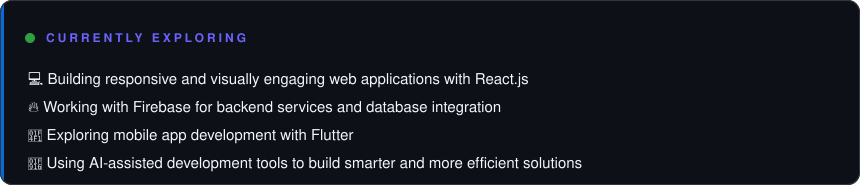
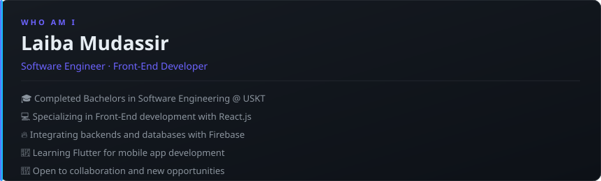

---

**See What I am currently into**

### `👾 whoami`

> *"Turning creative ideas into interactive digital experiences."*

### `🛠️ tech stack`

 

**Frontend:** HTML, CSS, JavaScript, React.js

**Backend & Database:** Node.js, Firebase, SQL

**Programming Languages:** Python, Java, C++, C#

**Tools & Platforms:** VS Code, GitHub, Vite, Android Studio

### 🐍 contribution snake

### `📊 contribution graph`

### `🤝 connect`

 

*Thanks for visiting — stats refresh daily via GitHub Actions* 🚀
